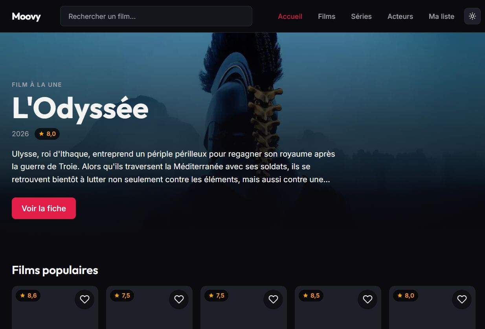
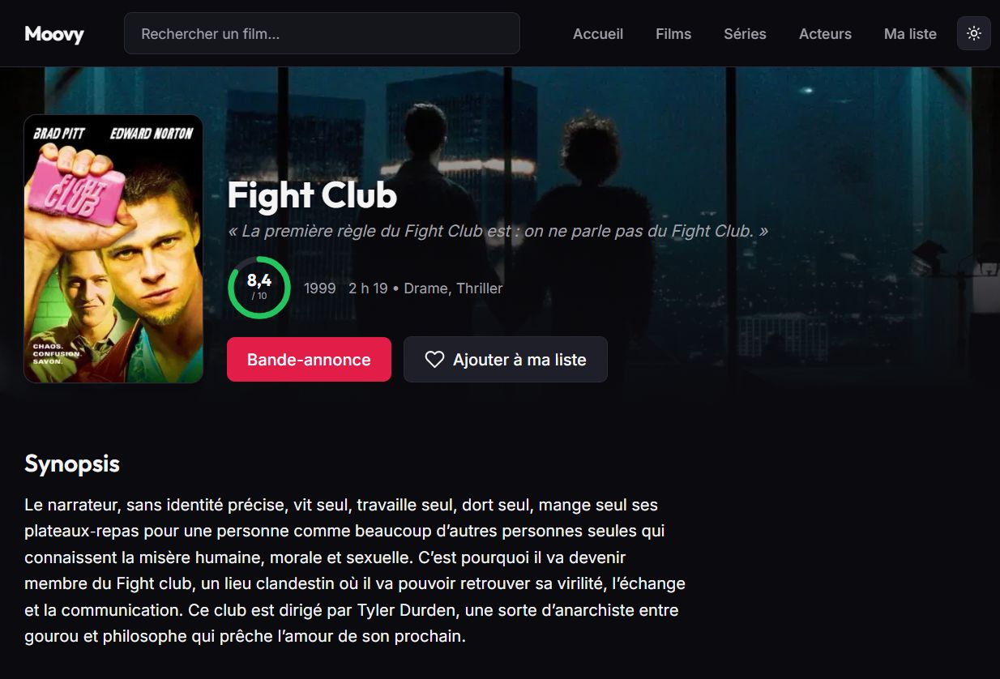
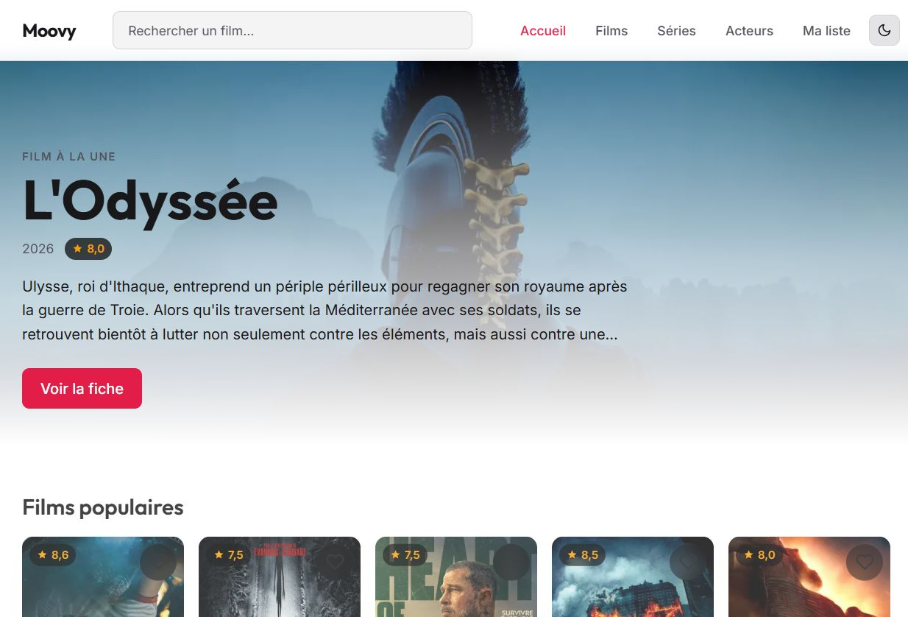
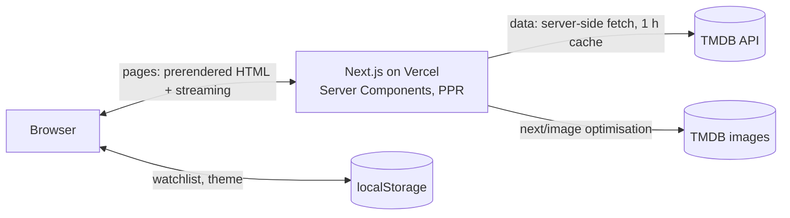

# 🎬 Moovy

[](https://github.com/mooktardev/moovy/actions/workflows/ci.yml)


**Your movie stopover: trending titles, detailed pages and a watchlist.** A portfolio project built on The Movie Database (TMDB) API. The interface is in French.

> 🌐 **Live demo: [moovy-seven.vercel.app](https://moovy-seven.vercel.app)** · 🇫🇷 [Version française](README.md)

## At a glance

- **Next.js 16 in real conditions**: Server Components, partial prerendering (PPR) with streaming, API keys never exposed to the browser.
- **Tested end to end**: 98 unit and component tests, 86 Playwright tests against a production build wired to a fake TMDB, an axe accessibility audit in both themes, all run in CI on every pull request.
- **Polished beyond the UI**: errors told apart (404 vs outage), full SEO with generated share images, WCAG 2.2 AA accessibility checked automatically.

## Screenshots

| Home (dark)                                                | Detail page                                               |
| ---------------------------------------------------------- | --------------------------------------------------------- |
|  |  |

_Home page, light theme:_



## ✨ Features

- **Home**: featured title and carousels of trending, popular movies and popular series.
- **Detail pages**: wide backdrop, poster, animated rating ring, clickable cast, TMDB reviews, "where to watch" streaming offers, embedded YouTube trailer, similar titles.
- **Catalogues** `/films` and `/series`: filters (genre, year, sort) and pagination.
- **Instant search** from the header (debounced, navigation driven by typing only).
- **Watchlist** ("Ma liste"): saved in the browser and synced across tabs.
- **People**: popular faces and `/person/[id]` pages (biography, de-duplicated filmography).
- **Sharing and SEO**: a share image generated for each title (poster, title, rating), Open Graph and Twitter tags, canonical URLs, schema.org structured data, `sitemap.xml` and `robots.txt`.
- **Dark and light themes**, synced across tabs, with no flash on load.
- **Micro-interactions** (fades, scroll reveals), disabled under `prefers-reduced-motion`.

## 🛠 Tech stack

| Area      | Choice                                                                                                                                                            |
| --------- | ----------------------------------------------------------------------------------------------------------------------------------------------------------------- |
| Framework | [Next.js 16](https://nextjs.org) (App Router, **Cache Components / PPR**)                                                                                         |
| UI        | [React 19](https://react.dev), [Tailwind CSS 4](https://tailwindcss.com), [Motion](https://motion.dev)                                                            |
| Language  | [TypeScript](https://www.typescriptlang.org) strict, ESLint with the React Compiler rules                                                                         |
| Testing   | [Vitest](https://vitest.dev) + [Testing Library](https://testing-library.com), [Playwright](https://playwright.dev), [axe](https://github.com/dequelabs/axe-core) |
| Data      | [TMDB API](https://developer.themoviedb.org), [JustWatch](https://www.justwatch.com) streaming offers via TMDB                                                    |
| Hosting   | [Vercel](https://vercel.com), [GitHub Actions](.github/workflows/ci.yml) CI                                                                                       |

## 🏗 Architecture



- **TMDB keys never exposed**: the API client is server-only (`import "server-only"`); no TMDB request leaves the browser.
- **Caching and performance**: TMDB responses are cached for 1 h; the static shell responds instantly and data streams in behind skeletons.
- **Browser state without setState in effects**: the watchlist and the theme are external stores read with `useSyncExternalStore`; the server renders the default state and the browser takes over with no hydration mismatch.
- **Errors told apart**: an invalid id or a TMDB 404 leads to the 404 page; an outage or rate limit leads to the error page with a "Retry" button ([`tmdb-errors.ts`](src/lib/tmdb-errors.ts)).
- **SEO** ([`seo.ts`](src/lib/seo.ts), [`og.tsx`](src/lib/og.tsx)): canonical set per page, share images rendered by `next/og` with the site font bundled, escaped JSON-LD.
- **Accessibility**: WCAG 2.2 AA checked by axe on every page; dedicated text colours (`--primary-text`, `--danger`) keep contrast in both themes, plus heading hierarchy, visible focus and touch targets ≥ 40 px.

## 🧩 Technical challenges

A few problems I ran into, and what they taught me.

| Problem                                                                                  | Solution                                                                                                                                              |
| ---------------------------------------------------------------------------------------- | ----------------------------------------------------------------------------------------------------------------------------------------------------- |
| Clicking a search result bounced back to `/search` 300 ms later.                         | Navigation is triggered by typing only, never by a URL change, and any navigation cancels the pending search. Locked in by tests before any refactor. |
| A TMDB outage showed "Movie not found".                                                  | TMDB errors carry their HTTP status: only a 404 leads to the 404 page. An e2e test simulates an outage and checks the error page.                     |
| The React Compiler flagged `setState` calls in effects (localStorage, clock).            | Moved to `useSyncExternalStore`: no more cascading renders, and cross-tab sync for free.                                                              |
| Every page declared the home page as its canonical URL.                                  | A canonical set in the layout is inherited everywhere, so it is now set per page. Same trap with `openGraph`, which Next replaces instead of merging. |
| Share images ignored bold, and the ★ character triggered a font download at render time. | Outfit bundled in two weights, star drawn as SVG; a test fails if rendering an image touches the network.                                             |
| `next dev` reloaded pages in a loop after adding the fonts.                              | A computed file path made Turbopack watch the whole project; literal paths fixed it.                                                                  |
| E2E tests depended on an API key and on data that changes.                               | A fake TMDB server, selected with `TMDB_API_URL`, serves stable data; CI builds and tests the app without any secret.                                 |
| The brand pink only reached 4.2:1 on the dark background.                                | A dedicated text colour, lighter in dark mode and darker in light mode; the original pink stays for backgrounds and icons.                            |

## 🚀 Running locally

```bash
npm install
cp .env.example .env.local   # then add a TMDB key
npm run dev                  # http://localhost:3000
```

Keys are created at [themoviedb.org/settings/api](https://www.themoviedb.org/settings/api).

| Variable               | Purpose                                                                                    |
| ---------------------- | ------------------------------------------------------------------------------------------ |
| `TMDB_ACCESS_TOKEN`    | TMDB v4 access token (recommended)                                                         |
| `TMDB_API_KEY`         | TMDB v3 key, used when no token is set                                                     |
| `NEXT_PUBLIC_SITE_URL` | Public URL (canonical, sitemap, share images). Default: Vercel domain, or localhost in dev |
| `TMDB_API_URL`         | TMDB API URL; e2e tests point it to the fake server                                        |

## ✅ Quality

| Command             | Purpose                                                     |
| ------------------- | ----------------------------------------------------------- |
| `npm test`          | Unit and component tests (Vitest + Testing Library)         |
| `npm run test:e2e`  | End-to-end tests and accessibility audit (Playwright + axe) |
| `npm run lint`      | ESLint, including the React Compiler rules                  |
| `npm run typecheck` | Next route types + TypeScript                               |

E2E tests build the app for production (into `.next-e2e`) and wire it to a **fake TMDB** ([`e2e/mock-tmdb`](e2e/mock-tmdb)): no key, no network, stable data. They cover the main journeys (home, detail pages, cast, catalogues, search, watchlist and its cross-tab sync), the 404 and error pages, the theme, SEO tags and accessibility, on desktop and mobile. First local run: `npx playwright install chromium`.

[CI](.github/workflows/ci.yml) runs formatting, lint, types and unit tests, then the production build and e2e tests, on every push and pull request.

## 📁 Structure

```
src/
├── app/            # App Router routes, share images, sitemap, robots
├── components/     # UI components (cards, carousels, detail pages, header…)
├── lib/            # TMDB client (server-only), errors, SEO, French formatting, watchlist, theme
└── types/          # TMDB response types
e2e/                # Playwright tests + fake TMDB server (mock-tmdb/)
assets/fonts/       # Outfit font for share images (OFL licence)
```

## 🙏 Credits

- Movie data: [TheMovieDB](https://www.themoviedb.org/). This product uses the TMDB API but is not endorsed or certified by TMDB.
- Streaming offers: [JustWatch](https://www.justwatch.com/)
- Font: [Outfit](https://github.com/Outfitio/Outfit-Fonts) (SIL Open Font License)

---

© Moovy — portfolio project, built by Mooktar.
