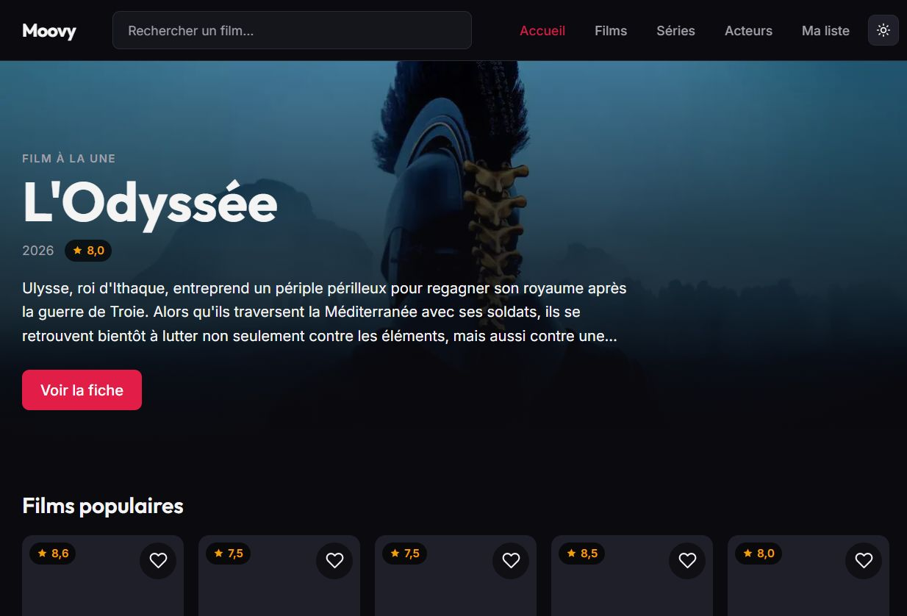
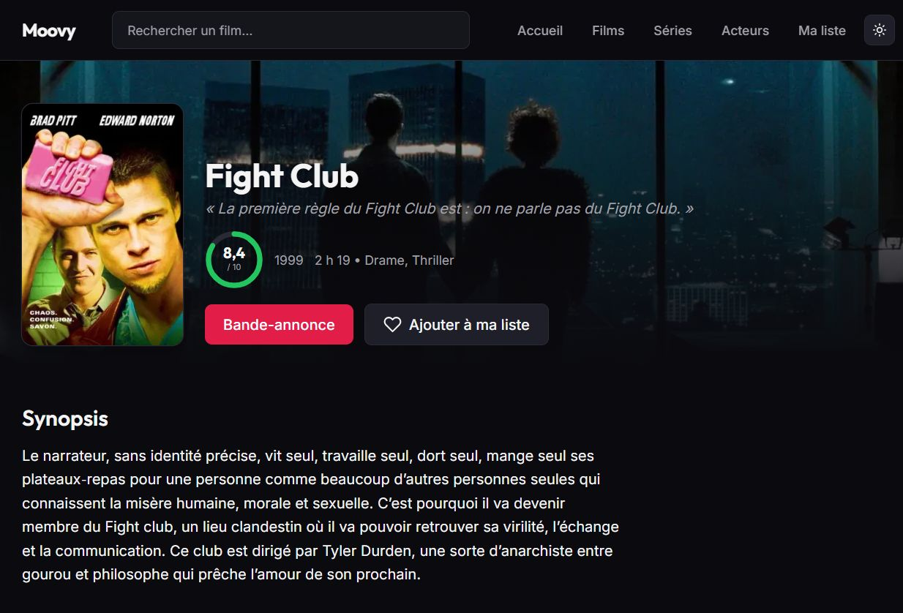
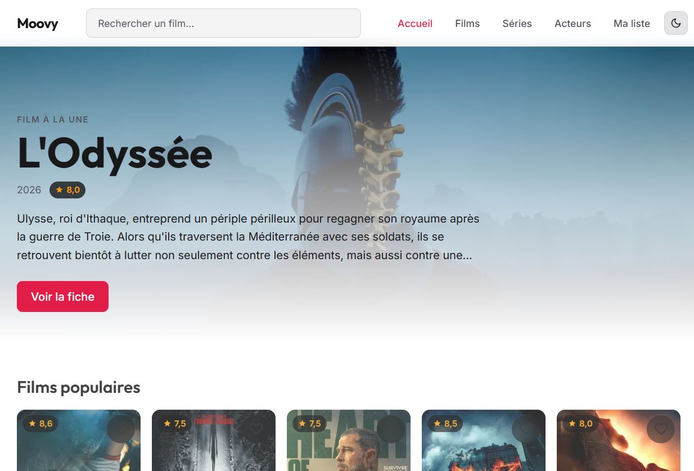

# 🎬 Moovy

**Votre escale cinéma : tendances, fiches détaillées et favoris.** Portfolio construit autour de l'API The Movie Database (TMDB).

> 🌐 **Démo en ligne : [moovy-seven.vercel.app](https://moovy-seven.vercel.app)**

## Captures d'écran

| Accueil (sombre)                                             | Fiche détaillée                                     |
| ------------------------------------------------------------ | --------------------------------------------------- |
|  |  |

_Accueil en thème clair :_



## ✨ Fonctionnalités

- **Accueil** : film à la une + carrousels de tendances, films et séries populaires
- **Fiches détaillées** : hero avec couverture étendue, affiche, anneau de note animé, tagline, casting cliquable, critiques TMDB, offres de streaming « Où regarder », bande-annonce YouTube intégrée, titres similaires
- **Catalogues** `/films` et `/series` : filtres (genre, année, tri), pagination
- **Recherche** instantanée avec barre dédiée (debounce, navigation pilotée par l'utilisateur)
- **Ma liste** : watchlist persistée en `localStorage`, synchronisée entre onglets, bouton cœur sur chaque carte
- **Acteurs** : page des visages populaires et fiches `/person/[id]` (photo, biographie, naissance/décès, filmographie dédoublonnée)
- **Thèmes** : sombre par défaut, clair en un clic (sans flash au chargement)
- **Micro-interactions** : fondu de navigation, apparitions au scroll, anneau de note animé — désactivées si `prefers-reduced-motion`

## 🛠 Stack technique

| Domaine     | Choix                                                                                                       |
| ----------- | ----------------------------------------------------------------------------------------------------------- |
| Framework   | [Next.js 16](https://nextjs.org) (App Router, **Cache Components / PPR**)                                   |
| UI          | [React 19](https://react.dev), [Tailwind CSS 4](https://tailwindcss.com)                                    |
| Animations  | [Motion](https://motion.dev) (ex-framer-motion)                                                             |
| Langage     | [TypeScript](https://www.typescriptlang.org) strict                                                         |
| Données     | [API TMDB](https://developer.themoviedb.org) + [JustWatch](https://www.justwatch.com) (offres de streaming) |
| Hébergement | [Vercel](https://vercel.com)                                                                                |

## 🏗 Choix d'architecture

- **Clés TMDB jamais exposées** : le client API vit côté serveur (`import "server-only"`) ; aucune requête TMDB ne part du navigateur.
- **Cache & performance** : réponses TMDB mises en cache 1 h via `revalidate` ; rendu partiel prérendu (PPR) avec skeletons Suspense — la coquille statique répond instantanément, les données suivent.
- **Watchlist locale** : données complètes stockées au moment de l'ajout via un contexte React — aucune dépendance backend.
- **Valeurs instables maîtrisées** : tout ce qui dépend de l'heure (`new Date()`) est calculé côté client pour rester compatible avec le prerender.
- **Images optimisées** : `next/image` avec `sizes` précis, tailles TMDB adaptées au contexte (cartes `w342`, fiches `w780`/`w1280`).
- **Accessibilité** : anneaux de focus visibles, zones tactiles ≥ 40 px, icônes avec `aria-label`, animations désactivables.

## 🚀 Installation locale

```bash
# 1. Dépendances
npm install

# 2. Clés TMDB — créer un fichier .env.local à partir de l'exemple
#    (clés à générer sur https://www.themoviedb.org/settings/api)
cp .env.example .env.local

# 3. Développement
npm run dev        # http://localhost:3000

# 4. Production locale
npm run build && npm start
```

## 📁 Structure

```
src/
├── app/                  # Routes App Router (/, /films, /series, /movie/[id], /tv/[id],
│                         #   /person/[id], /acteurs, /search, /ma-liste)
├── components/           # Composants UI (cartes, rails, fiches, footer…)
├── lib/                  # Client TMDB (server-only), format FR, images, watchlist
└── types/                # Types des réponses TMDB
```

## 🙏 Crédits

- Données cinématographiques : [TheMovieDB](https://www.themoviedb.org/)
- Offres de streaming : [JustWatch](https://www.justwatch.com/)

---

© Moovy — projet de portfolio, construit par Mooktar.
