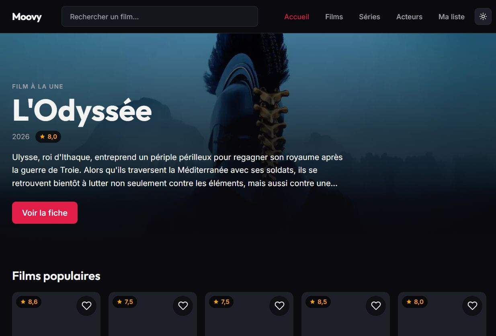
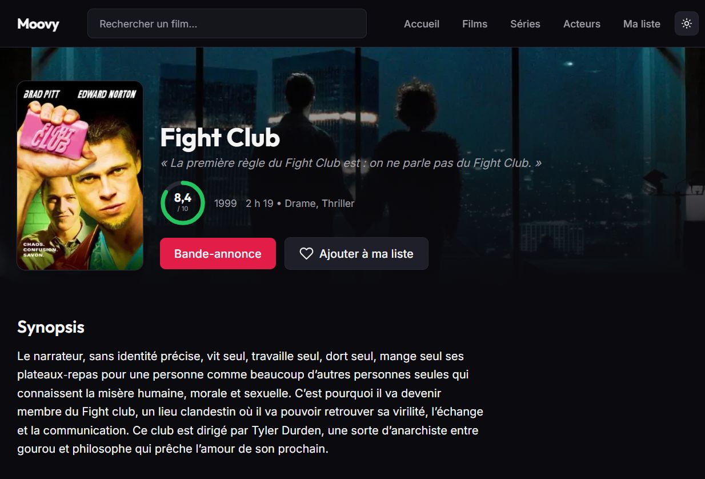
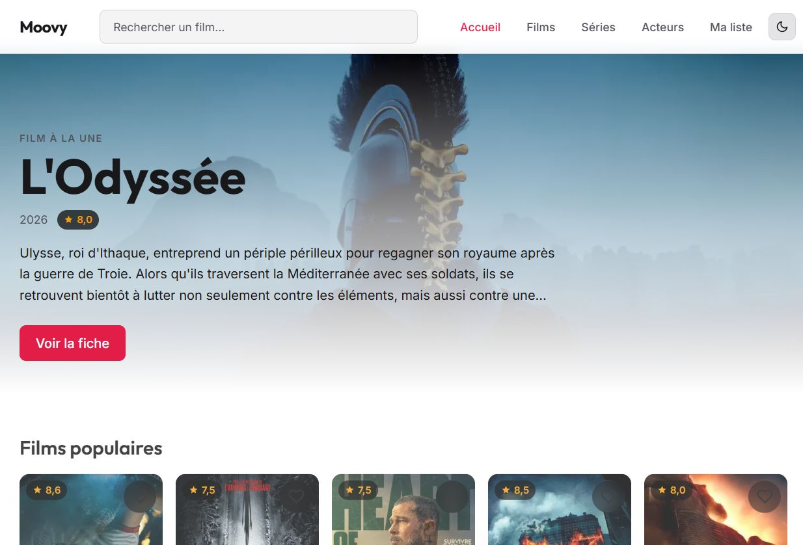
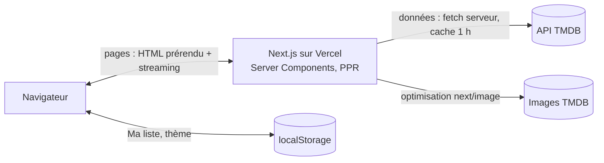

# 🎬 Moovy

[](https://github.com/mooktardev/moovy/actions/workflows/ci.yml)


**Votre escale cinéma : tendances, fiches détaillées et favoris.** Projet de portfolio construit autour de l'API The Movie Database (TMDB).

> 🌐 **Démo en ligne : [moovy-seven.vercel.app](https://moovy-seven.vercel.app)** · 🇬🇧 [English version](README.en.md)

## En bref

- **Next.js 16 en conditions réelles** : Server Components, rendu partiel prérendu (PPR) avec streaming, clés d'API jamais exposées au navigateur.
- **Testé de bout en bout** : 98 tests unitaires et de composants, 86 tests Playwright sur un build de production branché sur un faux TMDB, audit d'accessibilité axe dans les deux thèmes, le tout en CI à chaque pull request.
- **Soigné au-delà de l'interface** : erreurs distinguées (404 ou panne), SEO complet avec images de partage générées, accessibilité WCAG 2.2 AA vérifiée automatiquement.

## Captures d'écran

| Accueil (sombre)                                             | Fiche détaillée                                     |
| ------------------------------------------------------------ | --------------------------------------------------- |
|  |  |

_Accueil en thème clair :_



## ✨ Fonctionnalités

- **Accueil** : film à la une et carrousels de tendances, films et séries populaires.
- **Fiches détaillées** : couverture étendue, affiche, anneau de note animé, casting cliquable, critiques TMDB, offres de streaming « Où regarder », bande-annonce YouTube intégrée, titres similaires.
- **Catalogues** `/films` et `/series` : filtres (genre, année, tri) et pagination.
- **Recherche** instantanée depuis l'en-tête (debounce, navigation pilotée par la saisie).
- **Ma liste** : favoris enregistrés dans le navigateur, synchronisés entre onglets.
- **Acteurs** : visages populaires et fiches `/person/[id]` (biographie, filmographie dédoublonnée).
- **Partage et référencement** : image de partage générée pour chaque fiche (affiche, titre, note), balises Open Graph et Twitter, URL canonique, données structurées schema.org, `sitemap.xml` et `robots.txt`.
- **Thèmes** sombre et clair, synchronisés entre onglets, sans flash au chargement.
- **Micro-interactions** (fondus, apparitions au scroll), désactivées si `prefers-reduced-motion`.

## 🛠 Stack technique

| Domaine     | Choix                                                                                                                                                             |
| ----------- | ----------------------------------------------------------------------------------------------------------------------------------------------------------------- |
| Framework   | [Next.js 16](https://nextjs.org) (App Router, **Cache Components / PPR**)                                                                                         |
| UI          | [React 19](https://react.dev), [Tailwind CSS 4](https://tailwindcss.com), [Motion](https://motion.dev)                                                            |
| Langage     | [TypeScript](https://www.typescriptlang.org) strict, ESLint avec les règles du React Compiler                                                                     |
| Tests       | [Vitest](https://vitest.dev) + [Testing Library](https://testing-library.com), [Playwright](https://playwright.dev), [axe](https://github.com/dequelabs/axe-core) |
| Données     | [API TMDB](https://developer.themoviedb.org), offres de streaming [JustWatch](https://www.justwatch.com) via TMDB                                                 |
| Hébergement | [Vercel](https://vercel.com), CI [GitHub Actions](.github/workflows/ci.yml)                                                                                       |

## 🏗 Architecture



- **Clés TMDB jamais exposées** : le client API vit côté serveur (`import "server-only"`) ; aucune requête TMDB ne part du navigateur.
- **Cache et performance** : réponses TMDB mises en cache 1 h ; la coquille statique répond instantanément et les données arrivent en streaming derrière des skeletons.
- **État navigateur sans setState dans des effets** : Ma liste et le thème sont des stores externes lus avec `useSyncExternalStore` ; le serveur rend l'état par défaut, le navigateur prend le relais sans écart d'hydratation.
- **Erreurs distinguées** : un identifiant invalide ou un 404 TMDB mène à la page 404 ; une panne ou un quota dépassé mène à la page d'erreur avec « Réessayer » ([`tmdb-errors.ts`](src/lib/tmdb-errors.ts)).
- **SEO** ([`seo.ts`](src/lib/seo.ts), [`og.tsx`](src/lib/og.tsx)) : canonique posée page par page, images de partage rendues par `next/og` avec la police du site embarquée, JSON-LD échappé.
- **Accessibilité** : WCAG 2.2 AA vérifié par axe sur toutes les pages ; couleurs de texte dédiées (`--primary-text`, `--danger`) pour tenir le contraste dans les deux thèmes, hiérarchie de titres, focus visibles, zones tactiles ≥ 40 px.

## 🧩 Défis techniques

Quelques problèmes rencontrés, et ce qu'ils m'ont appris.

| Problème                                                                                                      | Solution                                                                                                                                                                            |
| ------------------------------------------------------------------------------------------------------------- | ----------------------------------------------------------------------------------------------------------------------------------------------------------------------------------- |
| Cliquer un résultat de recherche ramenait sur `/search` 300 ms plus tard.                                     | La navigation n'est déclenchée que par la saisie, jamais par un changement d'URL, et toute navigation annule la recherche en attente. Verrouillé par des tests avant toute refonte. |
| Une panne de TMDB affichait « Film introuvable ».                                                             | Les erreurs TMDB portent leur code HTTP : seul un 404 mène à la page 404. Un test e2e simule une panne et vérifie la page d'erreur.                                                 |
| Le React Compiler signalait des `setState` dans des effets (localStorage, horloge).                           | Passage à `useSyncExternalStore` : plus de rendu en cascade, et la synchronisation entre onglets en prime.                                                                          |
| Toutes les pages déclaraient l'accueil comme URL canonique.                                                   | Une canonique posée dans le layout est héritée partout : elle est désormais posée page par page. Même piège avec `openGraph`, que Next remplace au lieu de le fusionner.            |
| Les images de partage ignoraient le gras, et le caractère ★ déclenchait un téléchargement de police au rendu. | Police Outfit embarquée en deux graisses, étoile dessinée en SVG ; un test échoue si le rendu d'une image appelle le réseau.                                                        |
| `next dev` rechargeait les pages en boucle après l'ajout des polices.                                         | Un chemin de fichier calculé faisait surveiller tout le projet par Turbopack ; des chemins littéraux ont réglé le problème.                                                         |
| Les tests e2e dépendaient d'une clé et de données qui changent.                                               | Un faux serveur TMDB, sélectionné par `TMDB_API_URL`, sert des données stables ; la CI construit et teste l'app sans aucun secret.                                                  |
| Le rose de la marque n'atteignait que 4,2:1 sur le fond sombre.                                               | Une couleur dédiée au texte, plus claire en sombre et plus foncée en clair ; le rose d'origine reste pour les fonds et les icônes.                                                  |

## 🚀 Installation locale

```bash
npm install
cp .env.example .env.local   # puis renseigner une clé TMDB
npm run dev                  # http://localhost:3000
```

Les clés se génèrent sur [themoviedb.org/settings/api](https://www.themoviedb.org/settings/api).

| Variable               | Rôle                                                                                                   |
| ---------------------- | ------------------------------------------------------------------------------------------------------ |
| `TMDB_ACCESS_TOKEN`    | Jeton d'accès v4 TMDB (recommandé)                                                                     |
| `TMDB_API_KEY`         | Clé v3 TMDB, utilisée à défaut de jeton                                                                |
| `NEXT_PUBLIC_SITE_URL` | URL publique (canonique, sitemap, images de partage). Par défaut : domaine Vercel, ou localhost en dev |
| `TMDB_API_URL`         | URL de l'API TMDB ; les tests e2e la pointent vers le faux serveur                                     |

## ✅ Qualité

| Commande            | Rôle                                                              |
| ------------------- | ----------------------------------------------------------------- |
| `npm test`          | Tests unitaires et de composants (Vitest + Testing Library)       |
| `npm run test:e2e`  | Tests de bout en bout et audit d'accessibilité (Playwright + axe) |
| `npm run lint`      | ESLint, règles du React Compiler comprises                        |
| `npm run typecheck` | Types des routes Next + TypeScript                                |

Les tests e2e construisent l'application en production (dans `.next-e2e`) et la branchent sur un **faux TMDB** ([`e2e/mock-tmdb`](e2e/mock-tmdb)) : ni clé, ni réseau, des données stables. Ils couvrent les parcours principaux (accueil, fiches, casting, catalogues, recherche, Ma liste et sa synchronisation entre onglets), les pages 404 et d'erreur, le thème, les balises SEO et l'accessibilité, sur bureau et mobile. Première exécution locale : `npx playwright install chromium`.

La [CI](.github/workflows/ci.yml) lance formatage, lint, types et tests unitaires, puis le build de production et les tests e2e, à chaque push et pull request.

## 📁 Structure

```
src/
├── app/            # Routes App Router, images de partage, sitemap, robots
├── components/     # Composants UI (cartes, carrousels, fiches, en-tête…)
├── lib/            # Client TMDB (server-only), erreurs, SEO, format FR, Ma liste, thème
└── types/          # Types des réponses TMDB
e2e/                # Tests Playwright + faux serveur TMDB (mock-tmdb/)
assets/fonts/       # Police Outfit des images de partage (licence OFL)
```

## 🙏 Crédits

- Données cinématographiques : [TheMovieDB](https://www.themoviedb.org/). Ce produit utilise l'API TMDB sans être approuvé ni certifié par TMDB.
- Offres de streaming : [JustWatch](https://www.justwatch.com/)
- Police : [Outfit](https://github.com/Outfitio/Outfit-Fonts) (SIL Open Font License)

## 📄 Licence

Code sous licence [MIT](LICENSE). Les données et images de TMDB restent soumises aux [conditions d'utilisation de TMDB](https://www.themoviedb.org/api-terms-of-use), et la police Outfit (`assets/fonts`) à sa licence [OFL](assets/fonts/OFL.txt).

---

© Moovy — projet de portfolio, construit par Mooktar.
